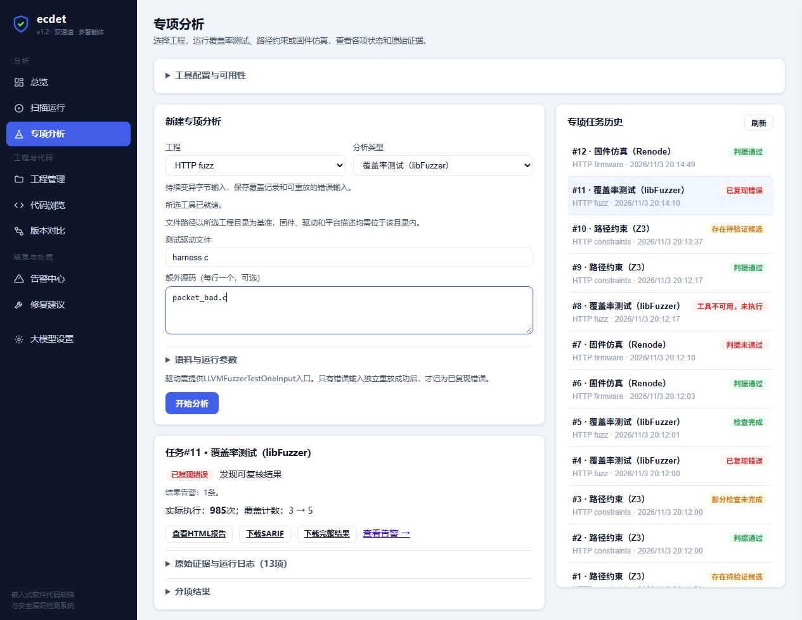

# 三项分析功能网页接入与验收结果

日期：2026年11月3日

**libFuzzer、Z3和Renode已接入现有网页，完成参数配置、后台排队执行、状态展示、告警入库、历史回看及报告下载。最终全量回归578项通过，0失败、0跳过；新增35项Python测试和13项前端行为检查。**

## 一、新增网页功能

左侧导航新增“专项分析”。页面复用现有工程，可选择三种分析类型：

| 分析类型 | 网页配置 | 结果展示 |
| --- | --- | --- |
| 覆盖率测试（libFuzzer） | 测试驱动、额外源码、语料、执行次数、时限和输入长度 | 实际执行次数、覆盖计数、错误重放结果及输入、编译与运行日志 |
| 路径约束（Z3） | 可选C文件、函数名、单次求解时间预算 | SAT、UNSAT及未完成项计数、候选输入、约束和模型范围 |
| 固件仿真（Renode） | ELF、REPL、UART、输入字节、预期输出、失败标记、仿真与进程时限 | 判据是否满足、缺少的输出、观察到的失败标记、UART日志与重放脚本 |

“工具配置与可用性”提供Clang和Renode路径保存与探测。工具设置使用独立键，与LLM配置分别保存。页面可以重复打开历史任务，自动刷新正在执行的任务，下载HTML报告、SARIF、完整JSON及原始证据。

普通扫描原有的动态开关继续运行源码harness；专项分析通过独立表单提供三个后端各自需要的输入。

## 二、状态与处理规则

| 实际情况 | 网页行为 |
| --- | --- |
| Z3找到可满足的越界输入 | 显示“存在待验证候选”，告警保持Suspected |
| libFuzzer错误输入重放成功 | 显示“已复现错误”，保存Detected事件 |
| Renode输出显式失败标记 | 显示“判据未通过”，保存固件级Detected事件 |
| 支持的Z3访问与不支持项同时存在 | 显示“部分检查未完成”，逐项计数 |
| 工具缺失、编译失败、超时或执行错误 | 显示对应失败状态，保留报告和可用日志 |
| 正常完成且未产生告警 | 按后端显示本次预算完成或判据通过 |

任务完成和检测结果分别记录。例如，故障固件的任务正常执行结束，其判据结果仍为FAIL。未知或不支持的检查不会被统计为通过。

提交前验证字段类型、整数预算、有限浮点数、十六进制输入、必要文件和输出判据。源码、固件、平台及语料须位于注册工程内；排队后执行前再次验证。下载同时核对规范化路径和本次产物清单，文件以附件返回并保留文件名。

存储复用现有运行、告警、设置表与JSON字段，没有修改数据库schema。

## 三、验证结果

### 3.1 自动化回归

| 检查 | 结果 |
| --- | --- |
| 最终增强环境全量回归 | 578项通过，0失败、0跳过，用时112.85秒 |
| 新增Python网页测试 | 35项通过；覆盖参数、状态、队列、设置隔离、结果持久化与下载边界 |
| 基础Python环境运行新增测试 | 35项通过，0失败、0跳过 |
| 前端行为检查 | 13项通过；覆盖参数映射、状态、转义、轮询、重复提交、错误恢复和附件下载链接 |
| JavaScript语法 | 通过 |
| 差异格式 | `git diff --check`通过 |

前端状态和下载修正发生在Python全量回归后，随后重新运行JavaScript语法与全部13项前端检查，并在真实浏览器中复验。

### 3.2 真实HTTP与后端执行

验收使用临时本地HTTP服务、独立数据库和拷贝后的样例工程，实际调用三个分析后端。

| 场景 | 实际结果 |
| --- | --- |
| Z3缺少下界检查 | FINDING，1条Suspected候选 |
| Z3完整边界检查 | PASS，0条候选 |
| Z3整个示例工程 | PARTIAL，同时保留候选和不支持项 |
| libFuzzer错误版 | FINDING，1条重放确认事件 |
| libFuzzer修复版 | COMPLETED，0条事件 |
| Renode正常固件 | PASS，0条事件 |
| Renode故障固件 | FAIL，1条固件运行事件 |
| Clang配置为不存在的文件 | 任务failed，后端UNAVAILABLE，0条事件 |
| 上一任务失败后继续执行Z3 | 正常完成，队列继续工作 |

9个任务均符合预期。每个任务的HTML、SARIF和清单中的原始产物均通过HTTP读取与内容校验。非法路径、预算、输入字节、任务类型、畸形JSON和下载路径逃逸均得到400响应。

本轮没有请求LLM端点。测试使用独立配置，未读取或修改用户原有模型设置。

### 3.3 真实浏览器操作

使用computer-use技能，在内置浏览器中实际完成：

1. 选择工程、填写参数并分别提交Z3、libFuzzer和Renode任务。
2. 观察任务从运行中自动刷新为相应结果：Z3候选、libFuzzer重放错误、Renode正常响应。
3. 回看缺工具任务，确认页面显示“工具不可用，未执行”。
4. 保存工具路径并观察可用性更新。
5. 下载SARIF、完整JSON和原始编译日志，核对下载文件与运行产物一致。

浏览器验收发现并修复两处问题：最初的通用FINDING标签把Z3候选写成“已复现错误”，现已按分析类型区分；两个报告按钮最初指向JSON查看接口，浏览器未触发下载，现已统一走附件端点，实际下载成功。



## 四、使用步骤

1. 重启现有网页服务并刷新页面，使新增后台接口与前端代码同时加载。
2. 在“工程管理”注册工程，然后进入“专项分析”。
3. 展开“工具配置与可用性”，设置Clang和Renode路径并保存。Z3需要在网页服务的Python环境中安装`constraints`扩展。
4. 选择工程、分析类型，按表单填写工程内文件路径和参数，点击“开始分析”。
5. 在结果区查看状态和分项结果，或下载报告、语料、错误输入与日志。

本机已验证的工具路径为：

```text
C:\Users\admin\Desktop\嵌入式项目\ecdet本地检查\steps345_20261103\tools\llvm-mingw-20261020-ucrt-x86_64\bin\clang.exe
C:\Users\admin\Desktop\嵌入式项目\ecdet本地检查\steps345_20261103\tools\renode-1.17.0\renode_1.17.0-portable\renode.exe
```

在项目根目录安装扩展：

```powershell
python -m pip install -e ".[hardware,syntax,constraints]"
```

恢复原数据目录启动时，原有模型配置继续从该目录读取。本轮验收服务使用独立数据目录。

## 五、代码与证据入口

- [网页任务验证与执行](../ecdet/webui/analysis.py)
- [HTTP接口](../ecdet/webui/server.py)、[后台队列接入](../ecdet/webui/runner.py)
- [网页交互](../ecdet/webui/static/app.js)、[导航](../ecdet/webui/static/index.html)、[样式](../ecdet/webui/static/style.css)
- [Python回归测试](../tests/test_web_analysis.py)、[前端行为检查](../tests/test_web_analysis_frontend.js)
- [真实HTTP验收脚本](../scripts/validate_web_analysis.py)
- [全量回归统计](../docs/validation_20261103/tests.json)
- [真实HTTP验收记录](../docs/validation_20261103/web_http.json)
- [浏览器验收记录](../docs/validation_20261103/web_browser.json)

